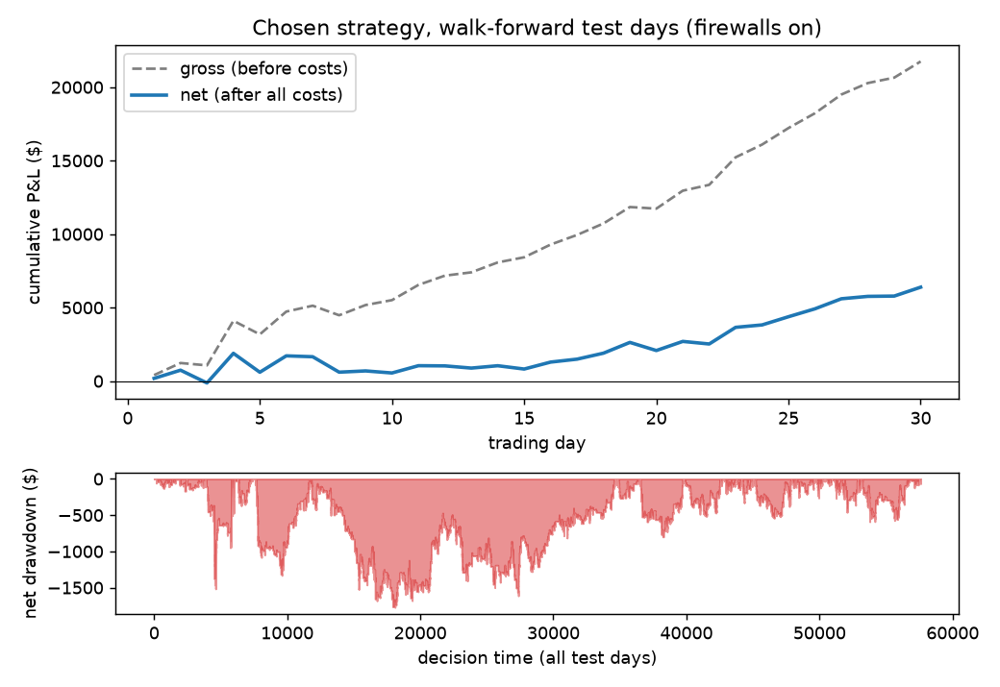
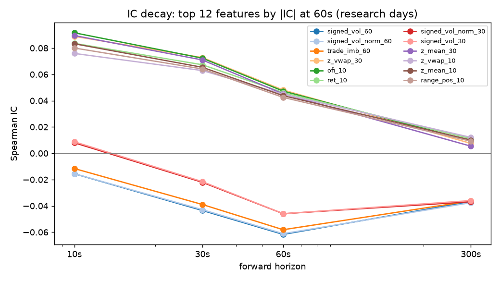
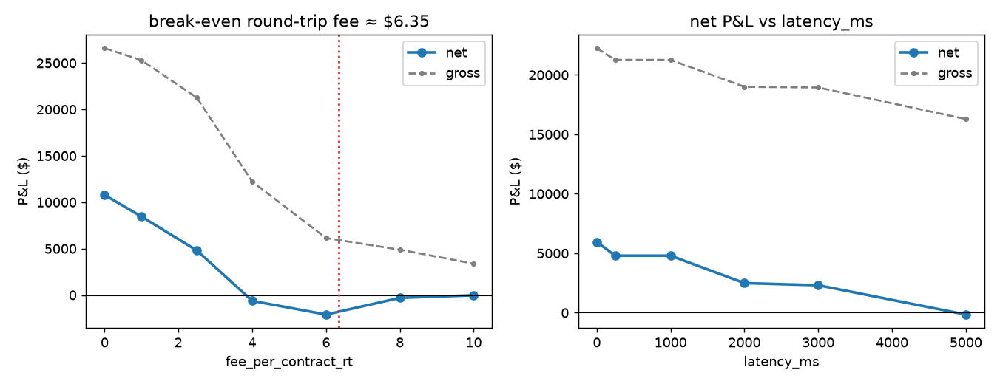
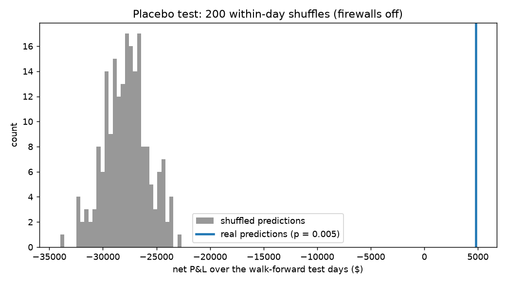

# CL microstructure strategy

[](https://github.com/jagadish-mun/cl-microstructure-strategy/actions/workflows/ci.yml)
[](LICENSE)


A short-horizon trading research project on WTI crude oil futures (CME: CL). It builds
78 order-flow and microstructure features from tick data, predicts the next 60 seconds of
price movement with linear models (OLS, Ridge, Lasso), and trades the forecasts in an
event-driven backtester that charges the spread, fees, slippage and liquidation penalties
and runs every order through 11 risk firewalls. Validation is a purged, embargoed
walk-forward, plus a 10-day holdout that was run once at the very end.

**The market data is simulated.** Section [Why synthetic data](#why-synthetic-data) explains
why and what that means for the results.

## Results

Net of all costs; one CL contract per trade; strategy and model chosen on the walk-forward
folds only.

| | Walk-forward test days (30) | Final holdout (10 days, run once) |
|---|---:|---:|
| **Net P&L** | **+$6,390** | **+$3,510** |
| **Net Sharpe (annualised)** | **5.1** | **5.2** |
| Max drawdown | $1,774 | $2,146 |
| Worst day | −$1,288 | −$1,570 |
| Gross P&L (before costs) | +$21,750 | +$10,870 |
| Costs: spread / fees / penalties | $12,410 / $2,920 / $30 | $5,900 / $1,410 / $50 |
| Trades / hit rate / profit factor | 1,168 / 49.2% / 1.18 | 564 / 46.6% / 1.18 |
| Model at 60 s: OOS R² vs zero / rank IC | 0.51% / 0.079 | 0.52% / 0.078 |

How much to trust these numbers:

- **Costs take about 70% of gross P&L.** At the default entry threshold (1 tick) the same
  model nets −$125 over the walk-forward days. It only makes money by trading the top 3% of
  its own forecasts. Break-even round-trip fee: $6.35 per contract (assumed: $2.50).
- **The placebo is clear.** Shuffling the predictions within each day (200 times) gives an
  average of −$27,810; the real predictions make +$4,798 under the same rules (p = 0.005).
- **Selection bias is material.** 46 strategy configurations were tried on the same 30 days.
  The deflated Sharpe ratio is 0.20 (probabilistic Sharpe vs zero: 0.95), so the
  walk-forward Sharpe of 5.1 should be read as optimistic. The 10-day holdout agrees, but
  10 days is too short to settle it.
- **Five other synthetic markets** (different seeds) run through the same frozen pipeline
  all end positive: net +$2,438 to +$9,850, Sharpe 2.6 to 9.1, OOS R² 0.55% to 0.80%.
- **It is a calm-market strategy.** On the half of test days with higher realized
  volatility it lost $630; on the calmer half it made $7,020.
- **Most important caveat:** the simulator plants a weak signal and the models find it.
  On real data the edge would be smaller or absent. See [Limitations](#limitations).

<p align="center">
  
  
  
  
</p>

The full generated report, with every table and plot, is in
[`reports/sample/report.md`](reports/sample/report.md).

## Architecture

```mermaid
flowchart LR
    A["Market data<br/>synthetic simulator or<br/>CSV / vendor adapter"] --> B["Validation + 1 s bars<br/>(OFI per quote update)"]
    B --> C["78 causal features<br/>+ forward targets in ticks"]
    C --> D["Purged walk-forward<br/>train-only preprocessing<br/>OLS (HAC) / Ridge / Lasso"]
    D --> E["Signal<br/>thresholds, hysteresis,<br/>stops, sizing"]
    E --> F["Risk firewalls<br/>(11, fixed order)"]
    F --> G["Execution<br/>latency, spread,<br/>L2 walk, fees"]
    G --> H["Accounting + metrics<br/>trade log, stress tests,<br/>holdout"]
```



| Stage | Code |
|---|---|
| Contract, calendar, config | `src/clstrat/contract.py`, `config.py`, `configs/default.yaml` |
| Simulator, adapters, validation, bars | `src/clstrat/data/` |
| Features and targets | `src/clstrat/features/` |
| Preprocessing, CV, models, evaluation | `src/clstrat/models/` |
| Signal, execution, firewalls, engines, metrics | `src/clstrat/backtest/` |
| Sweeps, placebo, seeds, holdout | `src/clstrat/research/` |
| Plots and report | `src/clstrat/report/build.py` |

Every parameter is in `configs/default.yaml` (sweep grids: `configs/sweep.yaml`).
Every run is seeded.

## Why synthetic data

Tick-level CL data with bid/ask quotes, sizes and trade aggressor side costs real money
from commercial vendors. Instead of shipping a repo that nobody can run, I wrote a market
simulator whose microstructure effects are known, calibrated it before doing any research,
and then froze it.

**What the simulator includes**

- A latent price with stochastic volatility, a U-shaped intraday pattern, calm/volatile
  daily regimes and an EIA inventory release every Wednesday at 10:30 ET (price jump,
  volatility and activity spike, wider spreads).
- Trade arrivals from a self-exciting (Hawkes) process; trade signs from split metaorders
  with power-law sizes, which gives long-memory order flow (Lillo–Farmer).
- Square-root price impact split into a permanent and a decaying transient part, which
  produce weak short-term momentum and mean reversion.
- A tick-size book (L1–L5) with a 1–3 tick spread, where the queue on the side the price is
  approaching shrinks, so book imbalance carries information about the next tick.
- A weak planted signal: a latent short-term pressure that tilts order flow and drift.

**Calibration** (60 days, seed 42): annualised vol 0.31 (target ≈0.35), mean spread 1.08
ticks, trade-sign autocorrelation 0.10 at lag 1 decaying to 0.04 at lag 100, 1-second mid
return autocorrelation −0.07, and a linear probe at 60 s with OOS R² 0.64% and rank IC 0.097
(target 0.5–3% and 0.03–0.10).

**What it leaves out**: full order-book dynamics (queues are a function of the latent price,
not of individual orders), other participants reacting to this strategy, queue position,
and any feedback from my own orders to the price beyond the spread and the depth I take.
The impact model is a single square-root law.

**Plugging in real data**: set `data.source: csv` and put one file per day in
`data/csv/quotes/YYYY-MM-DD.csv` and `data/csv/trades/YYYY-MM-DD.csv` (or `.parquet`)
with the schema in `src/clstrat/data/adapters.py`. Missing aggressor sides are classified
with Lee–Ready; files with several expiries are reduced to a front-month series with a
volume-based roll that only happens at day boundaries, so no return spans a roll.
`data.source: vendor` maps CME MBP-1/trades exports with vendor column names.
Credentials are never stored in the repo.

## Features

All features are trailing (strictly causal) and computed over 10, 30, 60 and 300-second
windows unless noted. A test perturbs every value after time *t* and checks that no
feature at or before *t* changes.

| Group | Feature | Formula |
|---|---|---|
| Order flow | `trade_imb_w` | Σ(buy vol − sell vol) / Σ(buy vol + sell vol) |
| | `signed_vol_w`, `signed_vol_norm_w` | Σ(buy − sell) lots; divided by *w* × mean volume per second over 30 min |
| | `ofi_w` | Cont–Kukanov–Stoikov OFI summed over each quote update / mean L1 depth |
| | `book_imb`, `book_imb_w` | (bid size − ask size) / (bid size + ask size) at L1, and its mean |
| | `book_imb_depth` | Σₗ (bidₗ − askₗ)/l / Σₗ (bidₗ + askₗ)/l over L1–L5 |
| | `micro_dev`, `micro_dev_w` | (microprice − mid) / tick, microprice = (ask·bid_sz + bid·ask_sz)/(bid_sz + ask_sz) |
| Price | `ret_w` | ln(mid / mid *w* seconds ago), bps |
| | `ema_f_s` | (EMA_f(mid) − EMA_s(mid)) / tick for (10, 60) and (30, 300) |
| | `z_vwap_w`, `z_mean_w` | (mid − rolling VWAP or mean) / rolling std of mid |
| | `range_pos_w` | position of the mid inside the rolling high-low range, centred at 0 |
| | `ret_skew_w` | rolling skewness of 1 s log returns (return-distribution skew) |
| | `book_skew` | Σ over L2–L5 (bid − ask) / Σ (bid + ask): asymmetry of the deeper book |
| | `rv_w`, `park_w`, `vol_ratio_30_300` | realized vol, Parkinson high-low vol, short/long vol ratio |
| Liquidity | `spread`, `spread_w` | quoted spread in ticks |
| | `intensity_w` | trades per second / average at the same time of day on previous days |
| | `kyle_w` | rolling slope of 1 s mid change on 1 s signed volume (Kyle's lambda) |
| | `amihud_w` | Σ\|return\| / Σ volume |
| Context | `tod_sin`, `tod_cos`, `min_to_eia`, `eia_day`, `vol_regime` | time of day, minutes to the EIA release, 30-min vol vs previous days' average |

Targets are the mid change in ticks from *t* + latency to *t* + latency + *h*, for
*h* ∈ {10, 30, 60, 300} s; 60 s is the primary target.

## Methodology

- **Walk-forward with purging and embargo.** Six rolling folds of 20 training and 5 test
  days over the first 50 days. Training rows whose target window overlaps the test period
  are dropped, plus an embargo of max(120 s, horizon + latency). The last 10 days are the
  holdout and were not used for any model or strategy choice.
- **Train-only preprocessing.** NaN fill values, 1st/99th percentile winsor bounds, the
  scaler, a correlation filter (|ρ| > 0.9) and Lasso stability selection (features chosen
  in ≥ 60% of 50 day-block subsamples) are all fitted inside each training fold. A test
  scrambles the test days and checks that every fitted quantity is unchanged.
- **Models.** Zero and AR(1) baselines, OLS with Newey–West standard errors (overlapping
  targets make plain errors too small), Ridge and Lasso with alpha chosen by purged inner
  CV. R² is measured against the zero forecast, which is the right benchmark for returns.
- **Execution.** Orders fill 1 s after the decision at the ask (buy) or bid (sell); size
  beyond L1 walks the book, then pays square-root impact. Fees $2.50 per round trip.
  Positions are flattened at 14:25 ET with a 1-tick penalty; firewall liquidations pay
  3 ticks.
- **Strategy.** Enter when the forecast is in the top/bottom 3% of the fold's training
  forecasts *and* exceeds the live spread plus fees in ticks; exit when it falls back
  through the median (hysteresis), or on an 8-tick stop, 12-tick target or 5-minute limit.
  Chosen from 46 tick- and percentile-threshold configurations by net Sharpe.
- **Firewalls** (checked in this order): drawdown halt, daily loss kill switch, loss-streak
  cooldown, EIA blackout, volatility breaker, stale data, spread guard, price band, max
  order size, max position, order throttle. On the walk-forward days the run with
  firewalls netted +$6,390 against +$4,798 without, and its worst day was −$1,288 against
  −$1,480. The most active were the loss-streak cooldown (111 blocked decisions) and the
  EIA blackout (30). `firewalls.enabled: false` turns them all off.
- **Two backtesters.** An event-driven engine (the reference) and a vectorized one for
  sweeps. With firewalls off they agree to the cent on daily P&L and every cost item.

## Limitations

- **The data is simulated, and I wrote the simulator.** The model recovers a signal I put
  there. Real CL order flow has many more participants and regime changes the simulator
  does not have. The numbers show the method works end to end; they are not evidence of a
  tradeable edge.
- **Short samples.** 30 walk-forward days and 10 holdout days. Sharpe estimates over
  10–30 days have wide error bars.
- **Selection bias.** The deflated Sharpe ratio of 0.20 says the walk-forward Sharpe is
  likely overstated by the search over 46 configurations.
- **Fills.** Market orders only, no queue position, no partial fills over time, and no
  price reaction to my own orders beyond the depth taken.
- **Two calibration changes to disclose.** (1) While building the features I found that the
  simulator's deeper book (L2–L5) leaked the planted signal (full-model rank IC 0.17 vs a
  0.10 ceiling), so I lowered that one parameter before any model existed. (2) The original
  calibration probe also scored on the final 10 days; it now uses research days only and
  still passes. Neither change touched a model or strategy choice. Of the five extra
  seeds, 7 and 123 were used to cross-check the calibration; 2024, 31337 and 99 were not.

**What I would do next**: real CME data through the existing adapter; queue-aware passive
execution (limit orders) to earn rather than pay the spread; a nonlinear model as a
comparison; trading the CL calendar spread or CL vs Brent; and paper trading on a live feed
before any capital.

## How to run

Requires Python 3.11+ (or [uv](https://github.com/astral-sh/uv), which the Makefile uses
when present).

```bash
git clone https://github.com/jagadish-mun/cl-microstructure-strategy.git
cd cl-microstructure-strategy
make all        # simulate -> features -> train -> backtest -> research -> holdout -> report -> lint -> tests
```

`make all` takes about 4.5 minutes from a fresh clone (including installing dependencies) on an Apple M5 Pro laptop and writes about 1.4 GB to
`data/` (most of it the five extra seed markets) plus tables and plots to `reports/`.
Individual steps: `make data`, `features`, `train`, `backtest`, `research`, `holdout`,
`report`, `test`; `python -m clstrat.cli --help` lists the CLI commands. The holdout
command stores its result in `data/models/holdout.yaml` and will not recompute it once
that file exists.

## License

MIT, see [LICENSE](LICENSE).
