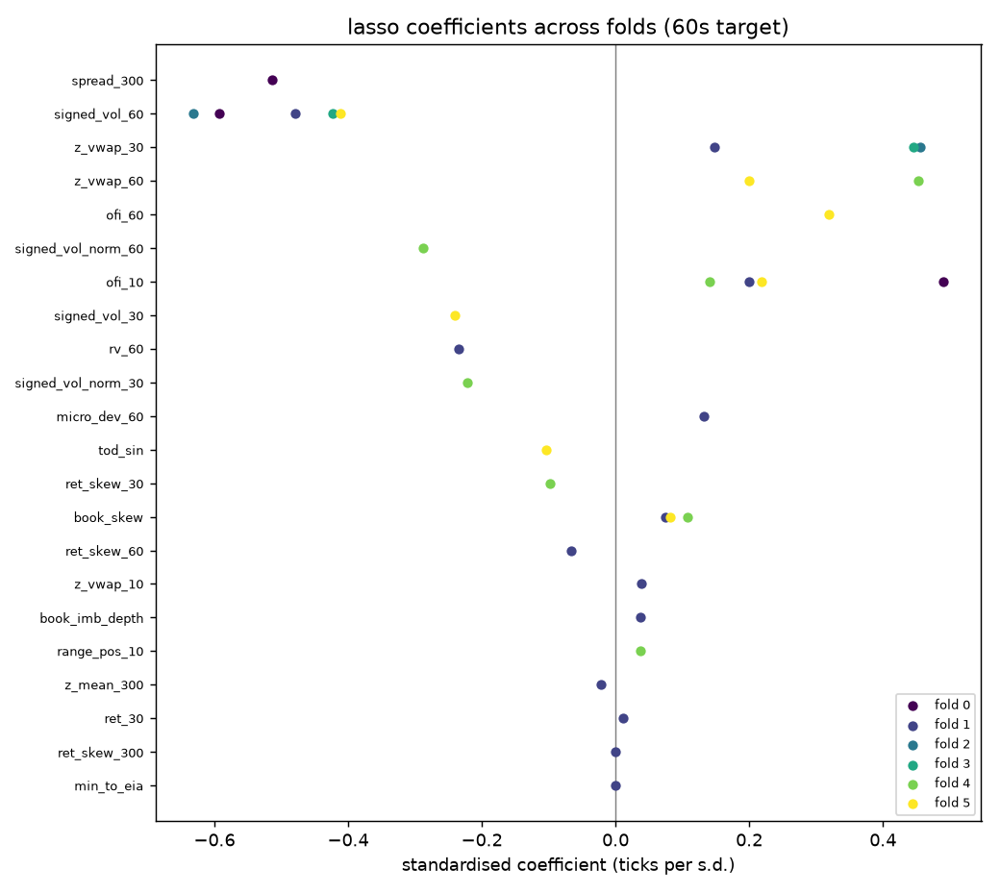
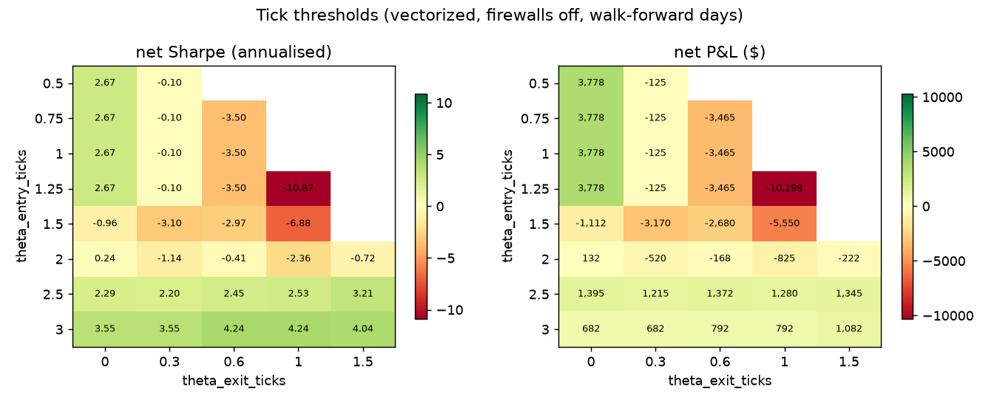
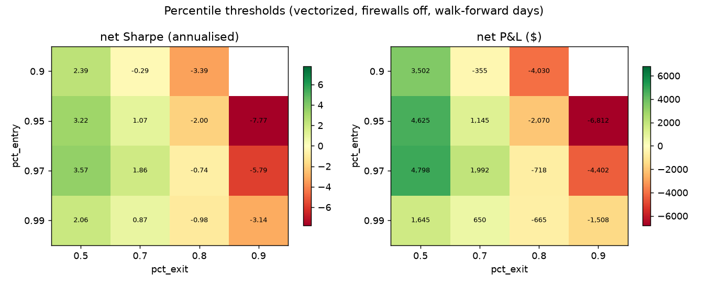
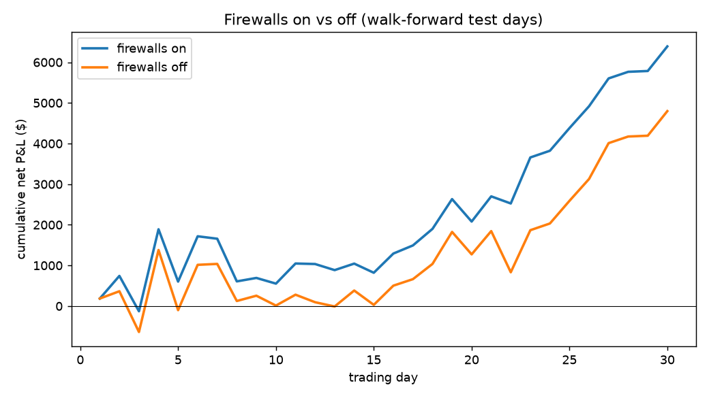
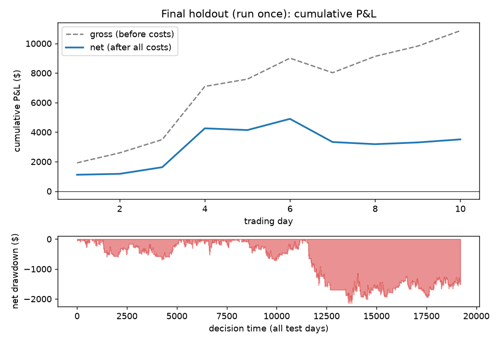

# CL microstructure strategy: research report

All data is **simulated** (see the README for why). Net-of-cost numbers come first. The final holdout was run once, after every choice below was fixed.

## 1. Data calibration

```
Calibration report
------------------------------------------------------------
annual_vol                  0.3099   [0.2975, 0.4025] OK
mean_spread_ticks           1.0767   [1, 1.3] OK
trades_per_sec              3.3459   
mid_ret_1s_acf1            -0.0687   [-0.5, 0] OK
sign_acf_1                  0.1000   [0.05, 1] OK
sign_acf_10                 0.0801   
sign_acf_100                0.0380   
sign_acf_1000               0.0037   
probe_oos_r2                0.0064   [0.005, 0.03] OK
probe_rank_ic               0.0967   [0.03, 0.1] OK
probe_n_test            29145.0000   
```

## 2. Features: strongest Spearman IC at the primary horizon

| feature | 10 | 30 | 60 | 300 |
|---|---|---|---|---|
| signed_vol_60 | -0.016 | -0.043 | -0.062 | -0.037 |
| signed_vol_norm_60 | -0.016 | -0.043 | -0.061 | -0.038 |
| trade_imb_60 | -0.012 | -0.039 | -0.058 | -0.036 |
| z_vwap_30 | 0.089 | 0.073 | 0.048 | 0.008 |
| ofi_10 | 0.092 | 0.072 | 0.047 | 0.009 |
| ret_10 | 0.084 | 0.067 | 0.046 | 0.011 |
| signed_vol_norm_30 | 0.008 | -0.022 | -0.046 | -0.037 |
| signed_vol_30 | 0.009 | -0.022 | -0.046 | -0.036 |
| z_mean_30 | 0.090 | 0.071 | 0.045 | 0.005 |
| z_vwap_10 | 0.076 | 0.063 | 0.045 | 0.012 |
| z_mean_10 | 0.083 | 0.065 | 0.044 | 0.010 |
| range_pos_10 | 0.080 | 0.064 | 0.042 | 0.009 |
| range_pos_30 | 0.085 | 0.067 | 0.042 | 0.002 |
| trade_imb_30 | 0.014 | -0.015 | -0.040 | -0.034 |
| z_vwap_60 | 0.081 | 0.063 | 0.038 | -0.000 |


## 3. Models (purged walk-forward, research days only)

| horizon | model | oos_r2 | ic_spearman | hit_rate | folds_r2_pos |
|---|---|---|---|---|---|
| 10 | zero | 0.0000 | nan | nan | 0.0000 |
| 10 | ar1 | 0.0043 | 0.0731 | 0.5287 | 1.0000 |
| 10 | ols | 0.0091 | 0.1034 | 0.5413 | 1.0000 |
| 10 | ridge | 0.0091 | 0.1031 | 0.5417 | 1.0000 |
| 10 | lasso | 0.0093 | 0.1034 | 0.5414 | 1.0000 |
| 30 | zero | 0.0000 | nan | nan | 0.0000 |
| 30 | ar1 | 0.0024 | 0.0550 | 0.5211 | 1.0000 |
| 30 | ols | 0.0081 | 0.0970 | 0.5396 | 1.0000 |
| 30 | ridge | 0.0082 | 0.0967 | 0.5395 | 1.0000 |
| 30 | lasso | 0.0083 | 0.0971 | 0.5393 | 1.0000 |
| 60 | zero | 0.0000 | nan | nan | 0.0000 |
| 60 | ar1 | -0.0009 | -0.0030 | 0.4953 | 0.3333 |
| 60 | ols | 0.0047 | 0.0788 | 0.5326 | 0.8333 |
| 60 | ridge | 0.0050 | 0.0790 | 0.5323 | 0.8333 |
| 60 | lasso | 0.0051 | 0.0792 | 0.5327 | 0.8333 |
| 300 | zero | 0.0000 | nan | nan | 0.0000 |
| 300 | ar1 | -0.0003 | 0.0042 | 0.4939 | 0.3333 |
| 300 | ols | -0.0059 | -0.0201 | 0.4886 | 0.1667 |
| 300 | ridge | -0.0036 | -0.0216 | 0.4830 | 0.3333 |
| 300 | lasso | -0.0041 | -0.0260 | 0.4820 | 0.3333 |

Chosen model: **lasso** (best pooled OOS R² at 60s).



Sign flips across folds: none.

### Selected features per fold

| fold | selected features |
|---|---|
| 0 | signed_vol_60, ofi_10, spread_300 |
| 1 | signed_vol_60, ofi_10, book_imb_depth, micro_dev_60, ret_30, z_vwap_10, z_vwap_30, z_mean_300, ret_skew_60, ret_skew_300, book_skew, rv_60, min_to_eia |
| 2 | signed_vol_60, z_vwap_30 |
| 3 | signed_vol_60, z_vwap_30 |
| 4 | signed_vol_norm_30, signed_vol_norm_60, ofi_10, range_pos_10, z_vwap_60, ret_skew_30, book_skew |
| 5 | signed_vol_30, signed_vol_60, ofi_10, ofi_60, z_vwap_60, book_skew, tod_sin |

## 4. Strategy on the walk-forward test days

Chosen configuration (from 46 tried): `{'strategy.threshold_mode': 'percentile', 'strategy.pct_entry': 0.97, 'strategy.pct_exit': 0.5}`, firewalls on.

| metric | value |
|---|---|
| net_pnl | 6,390 |
| net_sharpe | 5.12 |
| max_drawdown | 1,774 |
| worst_day | -1,288 |
| trades | 1,168 |
| hit_rate | 0.49 |
| profit_factor | 1.18 |
| gross_pnl | 21,750 |
| cost_spread_cost | 12,410 |
| cost_fees | 2,920 |
| cost_slippage | 0.00 |
| cost_eod_penalty | 30.00 |
| cost_forced_penalty | 0.00 |


### Threshold sweeps





### Cost sensitivity

Break-even round-trip fee: **$6.35** per contract (assumed: $2.50).


### Firewalls on vs off

| run | net_pnl | net_sharpe | max_drawdown | worst_day | es_10pct_day | trades | forced_penalty |
|---|---|---|---|---|---|---|---|
| firewalls on | 6,390 | 5.1 | 1,774 | -1,288 | -1,069 | 1,168 | 0.0 |
| firewalls off | 4,798 | 3.6 | 1,917 | -1,480 | -1,165 | 1,245 | 0.0 |



### Liquidation penalties

| eod_penalty_ticks | forced_liq_penalty_ticks | net_pnl | net_sharpe | penalty_cost |
|---|---|---|---|---|
| 0 | 0 | 6,420 | 5.15 | 0.00 |
| 0 | 3 | 6,420 | 5.15 | 0.00 |
| 0 | 6 | 6,420 | 5.15 | 0.00 |
| 0 | 10 | 6,420 | 5.15 | 0.00 |
| 1 | 0 | 6,390 | 5.12 | 30.00 |
| 1 | 3 | 6,390 | 5.12 | 30.00 |
| 1 | 6 | 6,390 | 5.12 | 30.00 |
| 1 | 10 | 6,390 | 5.12 | 30.00 |
| 2 | 0 | 6,360 | 5.09 | 60.00 |
| 2 | 3 | 6,360 | 5.09 | 60.00 |
| 2 | 6 | 6,360 | 5.09 | 60.00 |
| 2 | 10 | 6,360 | 5.09 | 60.00 |
| 4 | 0 | 6,300 | 5.04 | 120.00 |
| 4 | 3 | 6,300 | 5.04 | 120.00 |
| 4 | 6 | 6,300 | 5.04 | 120.00 |
| 4 | 10 | 6,300 | 5.04 | 120.00 |

### Placebo

Real net P&L $4,798 vs shuffled mean $-27,810; p = 0.005.


### Independent synthetic markets (frozen pipeline)

| seed | oos_r2 | ic_spearman | net_pnl | gross_pnl | net_sharpe | max_drawdown | trades |
|---|---|---|---|---|---|---|---|
| 7 | 0.0062 | 0.0825 | 9,850 | 29,565 | 9.0889 | 1,937 | 1480 |
| 123 | 0.0080 | 0.0927 | 4,308 | 21,885 | 4.5872 | 2,370 | 1341 |
| 2024 | 0.0059 | 0.0858 | 2,438 | 13,215 | 2.6058 | 2,258 | 817 |
| 31337 | 0.0055 | 0.0878 | 5,722 | 25,410 | 5.1461 | 2,755 | 1475 |
| 99 | 0.0076 | 0.0834 | 9,520 | 36,130 | 6.4306 | 3,248 | 1932 |

### Regimes

| split | group | days | net_pnl | net_per_day | gross_per_day | positive_days |
|---|---|---|---|---|---|---|
| realized_vol | high-vol half | 15 | -630.00 | -42.00 | 495.00 | 0.40 |
| realized_vol | low-vol half | 15 | 7,020 | 468.00 | 955.00 | 0.93 |
| eia | EIA day | 6 | 1,195 | 199.17 | 696.67 | 0.50 |
| eia | non-EIA day | 24 | 5,195 | 216.46 | 732.08 | 0.71 |
| generator_regime | calm | 30 | 6,390 | 213.00 | 725.00 | 0.67 |

### Selection bias

Configurations tried: 46. Annualised Sharpe 5.12; expected best Sharpe under no skill 7.68. Probabilistic Sharpe vs 0: 0.954. **Deflated Sharpe: 0.200.**

## 5. Final holdout (run once)

Model refitted on 2024-02-13 to 2024-03-11; holdout 2024-03-12 to 2024-03-25. Forecast OOS R² 0.0052, Spearman IC 0.078.

| metric | value |
|---|---|
| net_pnl | 3,510 |
| net_sharpe | 5.21 |
| max_drawdown | 2,146 |
| worst_day | -1,570 |
| trades | 564.00 |
| hit_rate | 0.47 |
| profit_factor | 1.18 |
| gross_pnl | 10,870 |
| cost_spread_cost | 5,900 |
| cost_fees | 1,410 |
| cost_slippage | 0.00 |
| cost_eod_penalty | 20.00 |
| cost_forced_penalty | 30.00 |


